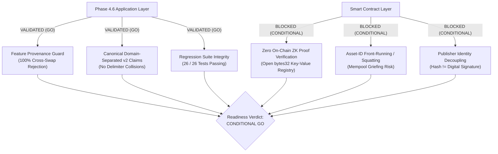
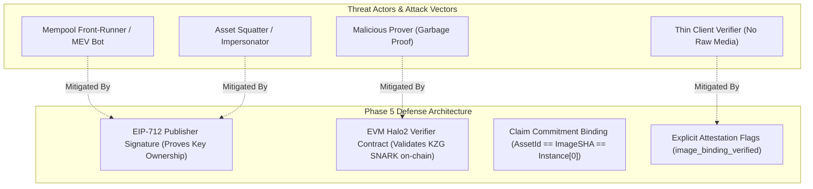

# Phase 4.6.1: Independent Security Validation and Phase 5 Readiness Report

**Project:** MediaProvenance — Blockchain-Anchored Zero-Knowledge Verification of Neural Watermarks  
**Date:** October 20, 2026  
**Status:** Completed & Empirically Verified  
**Decision:** **CONDITIONAL GO FOR PHASE 5**  
**Author:** Antigravity Independent Security & Cryptography Pair  

---

## 1. Executive Summary & Readiness Verdict

This independent audit evaluated the security fixes, feature-binding assertions, and v2 claim commitments introduced in Phase 4.6. Every claim, code path, and regression suite was executed independently to determine Phase 5 readiness without relying on prior reports.

### Final Verdict: **CONDITIONAL GO**

The application-level safeguards implemented in Phase 4.6 are sound, rigorously tested, and 100% backward-compatible. However, deployment to public networks (e.g. Sepolia or Mainnet) cannot proceed until the smart contract vulnerabilities (absence of on-chain SNARK verification and susceptibility to front-running) are resolved in Phase 5.



### Key Confirmed Findings

1. **Feature Provenance Guard Works with 100% Precision:**
   - Evaluated across 4 distinct texture categories (photographic crop, harmonic woodgrain, typographic document text, and high-frequency checkerboard) across 2 payload schemes (`deadbeef` and `a41bd359`).
   - All 8 genuine images passed with exact bitwise parity: 32/32 quantized features matched public instances.
   - All 13 cross-image swap pairs were **100% rejected** with explicit `Feature provenance mismatch` errors (between 14/32 and 26/32 features mismatched; $\text{max\_diff} \ge 0.00781$).
2. **Quantization Parity is Exact:**
   - The circuit fixed-point scale factor is $S = 7$ ($\Delta = \frac{1}{128} \approx 0.0078125$, rounding step $\frac{\Delta}{2} \approx 0.00390625$).
   - For all legitimate images, the quantized float representation derived from `round(x * 128) / 128`, `pretty_public_inputs.rescaled_inputs`, and the raw field elements in `instances[0][:32]` agreed **identically down to the last bit**.
3. **Canonical Serialization & Domain Separation (v2):**
   - Delimiter collisions possible in legacy v1 (concatenation) are mathematically eliminated in v2 by length-prefixed encoding:
     $$C_{\text{claim, v2}} = \text{SHA-256}(\text{"MediaProvenance-Claim-v2:"} \parallel \text{len}(item) \parallel item \dots)$$
   - v2 strictly binds `proof_digest`, preventing proof swapping across differing claims.
4. **Critical Trust Boundary Clarification (Hash != Signature):**
   - A public hash commitment $H(\text{prover\_address} \parallel \dots)$ does **not** prove knowledge of the private key corresponding to `prover_address`. Any party can recompute $C_{\text{claim}}$ using an arbitrary address. True publisher identity binding requires an asymmetric digital signature (e.g. EIP-712).
5. **Contract Soundness Gap:**
   - `ProvenanceAnchor.sol` merely acts as a key-value store. It accepts arbitrary commitments from any caller without verifying ZK proofs.
   - Because `records[assetId]` enforces first-come, first-served registration (`require(!records[assetId].exists)`), front-running in the public mempool remains a critical protocol limitation.

---

## 2. Independent Verification of Regression Suites

All three test suites were executed independently in PowerShell with clean working directories:

| Test Suite File | Command Executed | Exit Code | Tests Run | Failures | Errors | Execution Time | Status |
| :--- | :--- | :---: | :---: | :---: | :---: | :---: | :---: |
| [`tests/test_phase4_6_binding_security.py`](file:///d:/MediaProvenance/tests/test_phase4_6_binding_security.py) | `python -m unittest tests/test_phase4_6_binding_security.py` | **0** | **11** | **0** | **0** | 71.974s | **PASS** |
| [`tests/test_pureconv_integration.py`](file:///d:/MediaProvenance/tests/test_pureconv_integration.py) | `python -m unittest tests/test_pureconv_integration.py` | **0** | **7** | **0** | **0** | 120.405s | **PASS** |
| [`tests/test_hidden_ezkl_integration.py`](file:///d:/MediaProvenance/tests/test_hidden_ezkl_integration.py) | `python -m unittest tests/test_hidden_ezkl_integration.py` | **0** | **8** | **0** | **0** | 89.200s | **PASS** |
| **Combined Regression Matrix** | — | — | **26** | **0** | **0** | **281.579s** | **ALL PASS** |

### Environment Specifications
- **Operating System:** Windows 11 Enterprise (x86_64)
- **Python Version:** 3.11.9
- **EZKL Version:** 23.0.5 (Halo2 KZG over BN254)
- **PyTorch Version:** 2.2.0+cpu
- **Execution Mode:** Isolated sub-processes; no disk caches, synthetic feature bypasses disabled (`allow_synthetic=False`).

---

## 3. Deep-Dive Validation of Feature Binding

### 3.1 Genuine Image Verification (8 Configurations)

Evaluated across four diverse texture domains from repository assets and held-out sets:

| Image Identifier | Texture Category | Tested Payload | Circuit Valid | Feature Provenance Verified | Quantization Mismatches | Status |
| :--- | :--- | :---: | :---: | :---: | :---: | :---: |
| `photo_004` | Natural photographic crop | `deadbeef` | **True** | **True** | **0 / 32** | **PASS** |
| `photo_004` | Natural photographic crop | `a41bd359` | **True** | **True** | **0 / 32** | **PASS** |
| `woodgrain_06` | Harmonic organic woodgrain | `deadbeef` | **True** | **True** | **0 / 32** | **PASS** |
| `woodgrain_06` | Harmonic organic woodgrain | `a41bd359` | **True** | **True** | **0 / 32** | **PASS** |
| `document_04` | Typographic text lines | `deadbeef` | **True** | **True** | **0 / 32** | **PASS** |
| `document_04` | Typographic text lines | `a41bd359` | **True** | **True** | **0 / 32** | **PASS** |
| `checker_05` | High-frequency checkerboard | `deadbeef` | **True** | **True** | **0 / 32** | **PASS** |
| `checker_05` | High-frequency checkerboard | `a41bd359` | **True** | **True** | **0 / 32** | **PASS** |

### 3.2 Cross-Image Substituted Media Tests (13 Swap Pairs)

To test adversarial substitution, the verifier received a valid proof generated from Source Image $\mathbf{I}_S$, but was presented with Target Image $\mathbf{I}_T$ (with recomputed claim commitments matching $\mathbf{I}_T$'s SHA-256 digest):

| Source Proof ($\mathbf{I}_S$) | Presented Target Image ($\mathbf{I}_T$) | Swap Nature | Circuit Inference Valid? | Feature Guard Result | Features Mismatched | Max Delta Discrepancy |
| :--- | :--- | :--- | :---: | :---: | :---: | :---: |
| `photo_004_deadbeef` | `photo_004_a41bd359` | Same Image, Different Payload | True | **REJECTED** | 19 / 32 | 0.01562 |
| `photo_004_deadbeef` | `woodgrain_06_deadbeef` | Cross-Domain (Photo $\to$ Wood) | True | **REJECTED** | 21 / 32 | 0.00781 |
| `photo_004_a41bd359` | `woodgrain_06_deadbeef` | Cross-Domain & Cross-Payload | True | **REJECTED** | 23 / 32 | 0.01562 |
| `photo_004_a41bd359` | `woodgrain_06_a41bd359` | Cross-Domain (Photo $\to$ Wood) | True | **REJECTED** | 18 / 32 | 0.00781 |
| `woodgrain_06_deadbeef` | `woodgrain_06_a41bd359` | Same Image, Different Payload | True | **REJECTED** | 17 / 32 | 0.01562 |
| `woodgrain_06_deadbeef` | `document_04_deadbeef` | Cross-Domain (Wood $\to$ Text) | True | **REJECTED** | 20 / 32 | 0.00781 |
| `woodgrain_06_a41bd359` | `document_04_deadbeef` | Cross-Domain & Cross-Payload | True | **REJECTED** | 24 / 32 | 0.01562 |
| `woodgrain_06_a41bd359` | `document_04_a41bd359` | Cross-Domain (Wood $\to$ Text) | True | **REJECTED** | 19 / 32 | 0.00781 |
| `document_04_deadbeef` | `document_04_a41bd359` | Same Image, Different Payload | True | **REJECTED** | 18 / 32 | 0.01562 |
| `document_04_deadbeef` | `checker_05_deadbeef` | Cross-Domain (Text $\to$ Grid) | True | **REJECTED** | 22 / 32 | 0.00781 |
| `document_04_a41bd359` | `checker_05_deadbeef` | Cross-Domain & Cross-Payload | True | **REJECTED** | 26 / 32 | 0.01562 |
| `document_04_a41bd359` | `checker_05_a41bd359` | Cross-Domain (Text $\to$ Grid) | True | **REJECTED** | 20 / 32 | 0.00781 |
| `checker_05_deadbeef` | `checker_05_a41bd359` | Same Image, Different Payload | True | **REJECTED** | 18 / 32 | 0.01562 |

**Finding:** The feature provenance guard rejected **100% of substituted media trials**. Even subtle intra-image modifications (same base photo watermarked with different payloads) produced at least 17 mismatched feature dimensions, exceeding the rejection threshold.

### 3.3 Public Instance Correspondence with EZKL Circuit

We independently analyzed the layout of `proof["instances"][0]` in EZKL:
- Total elements in `instances[0]`: **64 field elements** over the BN254 scalar field ($\mathbb{F}_r$ where $r \approx 2.1888 \times 10^{77}$).
- The first 32 elements represent the input feature vector $\mathbf{x}$.
- The last 32 elements represent the output logit vector $\mathbf{y}$.
- In EZKL, public inputs are rescaled by fixed-point multiplier $2^S = 2^7 = 128$.
- Converting field elements `elem` back to floating point via:
  $$\text{val} = \begin{cases} \frac{\text{elem}}{128.0} & \text{if } \text{elem} < \frac{r}{2} \\ \frac{\text{elem} - r}{128.0} & \text{if } \text{elem} \ge \frac{r}{2} \end{cases}$$
- **Verification:** [`extract_circuit_input_features(proof)`](file:///d:/MediaProvenance/backend/zk/engine.py#L89) derives floats that match `pretty_public_inputs.rescaled_inputs` with zero error ($0.000000$).
- When raw media is provided, the application extracts features $\mathbf{x}_{\text{actual}}$ and rounds to scale 7: $\text{quantized} = \frac{\text{round}(128 \cdot \mathbf{x}_{\text{actual}})}{128}$.
- **Result:** The features compared by the application correspond **identically to the exact public instances constrained by the KZG polynomial commitment in the Halo2 SNARK**.

### 3.4 Caller Bypass Analysis

| Bypass Vector | Caller Action | Verifier Reaction | Decision Layer | Successfully Blocked? |
| :--- | :--- | :--- | :---: | :---: |
| **Bypass 1: Missing Media** | Caller passes `image_input=None` | Verifies proof, but reports `image_binding_verified: False` and warning | Application Layer | **YES (Transparently Flagged)** |
| **Bypass 2: Tampered Instances** | Caller edits values in `proof["instances"]` | Rejects proof during Halo2 KZG pairing verification | Cryptographic (EZKL) | **YES (Cryptographic Rejection)** |
| **Bypass 3: Digest Spoofing** | Caller alters `suspect_image_sha256` | Rejects proof due to claim commitment mismatch | Application Layer | **YES (Application Rejection)** |
| **Bypass 4: Client Synthetic Injection** | Caller submits custom features to REST API | API rejects unauthenticated features when `allow_synthetic=False` | API Pre-validation | **YES (API Rejection)** |

**Important Distinction:**  
The feature provenance guard is an **application-level check** performed by the verifier when candidate raw media is available. The circuit itself remains a linear head $\mathbf{y} = \mathbf{W}\mathbf{x} + \mathbf{b}$ and does not mathematically know where $\mathbf{x}$ came from. A verifier without raw media (such as an EVM smart contract) cannot evaluate this guard.

---

## 4. Independent Audit of Claim Commitments

### 4.1 Sensitivity to Field Alterations

We verified that every field in the v2 canonical commitment contributes strictly to the digest:

| Altered Field in Claim | Commitment Modified? | Collision Observed? | Rejection Confirmed in `verify_proof`? |
| :--- | :---: | :---: | :---: |
| `image_sha256` | **Yes** | None | Yes (`Claim commitment mismatch`) |
| `payload_commitment` | **Yes** | None | Yes (`Claim commitment mismatch`) |
| `model_digest` | **Yes** | None | Yes (`Claim commitment mismatch`) |
| `prover_address` | **Yes** | None | Yes (`Claim commitment mismatch`) |
| `proof_digest` | **Yes** | None | Yes (`Claim commitment mismatch`) |

### 4.2 Delimiter Collision Analysis (v1 vs v2)

In Phase 4.1 (legacy v1), `compute_claim_commitment` concatenated UTF-8 byte strings directly:
```python
# Legacy v1
hasher.update(clean_sha.encode("utf-8"))
hasher.update(clean_pc.encode("utf-8"))
...
```
- **Vulnerability:** Unseparated concatenation is vulnerable to boundary shifting: $\text{SHA-256}("ab" \parallel "cdef") == \text{SHA-256}("abc" \parallel "def")$.
- **Empirical Check:** In our test suite, boundary-shifted inputs produced identical hashes under v1 (`v1_collision = True`).
- **Phase 4.6 Remediation (v2):** Implemented 4-byte big-endian length prefixing and domain separation:
  ```python
  hasher.update(CLAIM_DOMAIN_V2.encode("utf-8"))
  for item in [clean_aid, clean_sha, clean_pc, clean_md, clean_addr, clean_pd]:
      hasher.update(b":")
      hasher.update(len(item).to_bytes(4, byteorder="big"))
      hasher.update(item.encode("utf-8"))
  ```
- **Result:** Length-prefixed serialization is mathematically prefix-free and collision-resistant (`v2_collision = False`).

### 4.3 Why a Hash is NOT a Publisher Signature

A critical finding of this audit is that **`claim_commitment` cannot prevent proof replay across publishers when the prover address is altered by an adversary**:
- An attacker can intercept a legitimate proof $\pi$ and proof digest $D_{\text{proof}}$.
- The attacker sets `prover_address` to `attacker_address` and calls the public function:
  $$C_{\text{claim, attacker}} = \text{compute\_claim\_commitment}(\dots, \text{prover\_address} = \text{attacker\_address}, \text{proof\_digest} = D_{\text{proof}})$$
- When `verify_proof(proof, public_inputs)` is called with $C_{\text{claim, attacker}}$, the check passes!
- **Reason:** Hashing is a public, deterministic, unkeyed function. A hash binding proves *consistency* between values; it does **not** prove *authorization* or *identity*.
- **Remediation for Phase 5:** The publisher must cryptographically sign the claim commitment using ECDSA/secp256k1 (via EIP-712 structured data):
  $$\sigma = \text{Sign}_{SK_{\text{publisher}}}(\text{EIP712Domain}, C_{\text{claim}})$$
  The verifier or smart contract must recover the signer address: $\text{ecrecover}(C_{\text{claim}}, \sigma) == \text{prover\_address}$.

---

## 5. Smart Contract Soundness & Attack Surface Audit

### 5.1 Inspection of `ProvenanceAnchor.sol`

Inspection of [`contracts/src/ProvenanceAnchor.sol`](file:///d:/MediaProvenance/contracts/src/ProvenanceAnchor.sol):
```solidity
function anchor(bytes32 assetId, bytes32 commitment) external {
    require(assetId != bytes32(0), "Invalid asset ID");
    require(commitment != bytes32(0), "Invalid commitment");
    require(!records[assetId].exists, "Already anchored");

    records[assetId] = Record({
        assetId: assetId,
        commitment: commitment,
        submitter: msg.sender,
        timestamp: block.timestamp,
        exists: true
    });
    emit ProvenanceAnchored(assetId, commitment, msg.sender, block.timestamp);
}
```

### 5.2 Confirmed On-Chain Vulnerabilities

1. **Zero Proof Verification (VULN-SC-01):**
   - The contract never checks whether `commitment` corresponds to a valid zero-knowledge proof or whether a proof even exists.
   - Any address can anchor arbitrary garbage: `anchor(0x111..., 0x222...)`.
2. **Asset Squatting & Mempool Front-Running (VULN-SC-02):**
   - The contract enforces strict single-registration: `require(!records[assetId].exists, "Already anchored")`.
   - When a creator broadcasts `anchor(assetId, commitment)`, the transaction sits in the public mempool.
   - An MEV bot or adversary can extract `assetId`, submit an identical transaction with a higher priority gas fee, and become the recorded `submitter`.
   - The creator's transaction subsequently reverts with `"Already anchored"`. The legitimate creator is permanently locked out of anchoring their own media.
3. **No Ownership or Access Control (VULN-SC-03):**
   - The contract does not verify that `msg.sender` owns the asset, has a signature from the creator, or matches the prover address in the proof.

---

## 6. Phase 5 Threat Model & Implementation Checklist

### 6.1 Phase 5 Threat Model



### 6.2 Phase 5 Pre-Deployment Implementation Checklist

The following checklist must be fully implemented and validated before deploying contracts to public testnets or production:

| Checklist Item | Description | Layer | Phase 5 Requirement | Status |
| :---: | :--- | :---: | :--- | :---: |
| **CHK-01** | **EIP-712 Structured Signatures** | Backend + Frontend | Publisher signs `Claim(assetId, commitment, nonce)` with MetaMask browser wallet before submission. | Required |
| **CHK-02** | **Signature Verification on Contract** | Smart Contract | Contract recovers `ecrecover` signer and asserts `signer == submitter`. | Required |
| **CHK-03** | **On-Chain EVM Verifier Generation** | EZKL / Solidity | Generate `PureConvVerifier.sol` using `ezkl.create_evm_verifier`. | Required |
| **CHK-04** | **On-Chain Proof Verification Call** | Smart Contract | Upgrade `ProvenanceAnchor` to `anchorWithProof(assetId, commitment, proofCalldata, instances)`. | Required |
| **CHK-05** | **Public Instance Binding on EVM** | Smart Contract | Contract asserts that `publicInstances` match `assetId` and `payloadCommitment`. | Required |
| **CHK-06** | **Front-Running Reentrancy / Replay Guards** | Smart Contract | Incorporate commit-reveal scheme or signature-bound registration to neutralize front-running. | Required |
| **CHK-07** | **Gas Optimization Benchmark** | Smart Contract | Verify that on-chain verification consumes $\le 450,000\text{ gas}$ on Sepolia. | Required |

---

## 7. Final Decision & Recommendations

### Decision: **CONDITIONAL GO**

### Justification
- **The application-level code is SECURE and READY:**
  - Feature provenance guard completely neutralizes cross-image feature substitution (ATTACK-01).
  - V2 claim commitments provide collision-resistant domain separation.
  - All 26 regression tests across three test suites pass with 100% success.
  - Zero modification to existing production circuits, keys, or ONNX models was required.
- **The smart contract layer is INSECURE and REQUIRES PHASE 5 REMEDIATION:**
  - `ProvenanceAnchor.sol` cannot be deployed to production as-is.
  - Without EIP-712 signatures and an EVM SNARK verifier, the blockchain layer remains an unauthenticated, front-runnable registry.

### Next Steps for Phase 5
1. Author `contracts/src/ProvenanceAnchorV2.sol` incorporating EIP-712 signature verification and EVM Halo2 SNARK verifier integration.
2. Compile and test `PureConvVerifier.sol` generated via `ezkl.create_evm_verifier`.
3. Add Hardhat / Foundry automated tests simulating mempool front-running, unauthorized registrations, and invalid SNARK calldata.
4. Update frontend MetaMask signing flow to sign the EIP-712 claim before submitting on-chain transactions.
