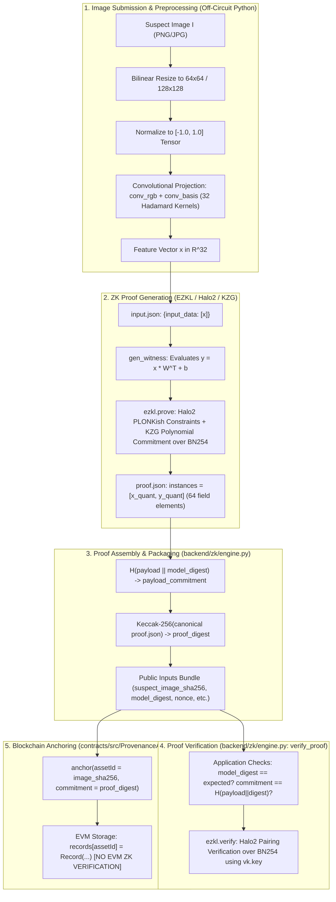

# Phase 4: Zero-Knowledge Proof Security Audit Report

**Project:** MediaProvenance — Blockchain-Anchored Zero-Knowledge Verification of Neural Watermarks  
**Date:** 2026-10-20  
**Audit Scope:** EZKL v23.0.5, Halo2 PLONKish Arithmetization, KZG Polynomial Commitments over BN254, Circuit Artifacts, Backend Engine & Verification Pipeline, Smart Contracts (`ProvenanceAnchor.sol`, `ProvenanceAudit.sol`).

---

## 1. Executive Summary

This security audit evaluated what the MediaProvenance zero-knowledge proof pipeline cryptographically establishes, what guarantees are purely off-circuit application assumptions, and whether proofs are securely bound to the host image and watermark payload.

### Core Audit Verdict:
1. **The Circuit Cryptographically Proves:**  
   Given a 32-dimensional (PureConv) or 64-dimensional (Legacy HiDDeN) floating-point feature vector $\mathbf{x}$, the public output logits $\mathbf{y}$ satisfy the linear transformation:
   $$\mathbf{y} = \mathbf{x} \mathbf{W}^T + \mathbf{b}$$
   under the fixed parameters $(\mathbf{W}, \mathbf{b})$ committed to the verification key $\text{vk}$.
2. **The Circuit Does NOT Prove:**  
   - That $\mathbf{x}$ was computed from any specific suspect image.
   - That $\mathbf{x}$ corresponds to the SHA-256 digest `suspect_image_sha256`.
   - That the recovered payload bits match `claimed_payload` or `payload_commitment`.
   - That the proof was submitted by `prover_address` or represents `asset_id`.
3. **Confirmed Vulnerabilities:**  
   - **Image Substitution (Critical):** An attacker can take a genuine proof generated for Image A and present it as proof of watermark presence for any arbitrary Image B. The verifier accepts this without error because `suspect_image_sha256` is not constrained in the circuit or verified in `verify_proof()`.
   - **Payload Re-labeling (Critical):** An attacker can alter `payload_hex` to an arbitrary fake payload and recompute `payload_commitment = H(fake_payload || model_digest)`. `verify_proof()` accepts the proof because it verifies the commitment string against the input string, but never checks whether the circuit's actual output logits agree with the claimed payload.
   - **Feature Forgery (High):** Preprocessing and convolutional feature extraction happen entirely off-circuit in Python. An untrusted prover can submit arbitrary synthetic feature vectors to the API.
   - **Unconstrained On-Chain Anchoring (Medium):** `ProvenanceAnchor.sol` accepts arbitrary `(bytes32 assetId, bytes32 commitment)` pairs without EVM proof verification or proof digest checks.

---

## 2. Pipeline Architecture & Trace

The end-to-end provenance workflow flows across five distinct stages:



### Exact Code References:
- **Preprocessing & Convolutional Feature Extraction:** [`backend/zk/features.py:36-63`](file:///d:/MediaProvenance/backend/zk/features.py#L36-L63) (`extract_pureconv_features`) and [`backend/carriers/pureconv/model.py:102-106`](file:///d:/MediaProvenance/backend/carriers/pureconv/model.py#L102-L106).
- **Circuit Specification:** [`models/ezkl_artifacts_pureconv/pureconv_head.onnx`](file:///d:/MediaProvenance/models/ezkl_artifacts_pureconv/pureconv_head.onnx) (single `Gemm` node: $1 \times 32 \to 1 \times 32$).
- **Witness & SNARK Prover:** [`backend/zk/engine.py:207-362`](file:///d:/MediaProvenance/backend/zk/engine.py#L207-L362) (`generate_proof`).
- **Cryptographic & Application Verifier:** [`backend/zk/engine.py:376-465`](file:///d:/MediaProvenance/backend/zk/engine.py#L376-L465) (`verify_proof`).
- **REST Endpoints:** [`backend/api/routes/proofs.py:59-104`](file:///d:/MediaProvenance/backend/api/routes/proofs.py#L59-L104) (`/proofs/generate`, `/proofs/verify`).
- **Smart Contract Registry:** [`contracts/src/ProvenanceAnchor.sol:33-47`](file:///d:/MediaProvenance/contracts/src/ProvenanceAnchor.sol#L33-L47) (`anchor`).

---

## 3. Circuit Inspection & Input Inventory

### 3.1 Public and Private Inputs
Inspection of `models/ezkl_artifacts_pureconv/settings.json` and `pureconv_head.onnx`:

| Signal Name | Visibility | Dimensions | Field Type | Source | Role in Statement |
| :--- | :---: | :---: | :---: | :---: | :---: |
| `carrier_projections` | **Public** | $[1, 32]$ | Quantized BN254 Scalar (`F32`, scale=7) | Prover `input.json` | Circuit Input $\mathbf{x}$ |
| `payload_logits` | **Public** | $[1, 32]$ | Quantized BN254 Scalar (`F32`, scale=7) | Circuit Output | Circuit Output $\mathbf{y}$ |
| `fc.weight` | **Fixed / Constant** | $[32, 32]$ | Quantized Constant (Diagonal $100.0$) | Hardcoded in `vk.key` | Linear layer weights $\mathbf{W}$ |
| `fc.bias` | **Fixed / Constant** | $[32]$ | Quantized Constant ($0.0$) | Hardcoded in `vk.key` | Linear layer bias $\mathbf{b}$ |
| `image_pixels` | *None* | — | — | — | **Not in Circuit** |
| `image_sha256` | *None* | — | — | — | **Not in Circuit** |
| `payload_hex` | *None* | — | — | — | **Not in Circuit** |
| `prover_address` | *None* | — | — | — | **Not in Circuit** |

Total public instances in `proof.json`: **64 field elements** ($32 \text{ inputs} + 32 \text{ outputs}$).

### 3.2 Exact Constrained Statement
$$\text{Constrained Statement: } \exists (\mathbf{x}, \mathbf{y}) \in \mathbb{F}_{p}^{32 \times 2} \quad \text{s.t.} \quad \mathbf{y} = \mathbf{x} \mathbf{W}^T + \mathbf{b} \quad \land \quad (\mathbf{x}, \mathbf{y}) = \text{instances}[0]$$

The proof proves **only** neural linear inference over the supplied 32 floating-point projections. It does **not** prove that the projections were extracted from any real image.

---

## 4. Empirical Tampering Test Matrix

The empirical test suite was executed via [`scripts/audit_zk_security.py`](file:///d:/MediaProvenance/scripts/audit_zk_security.py). Results:

| Test ID | Test Category | Mutation Applied | Expected Outcome | Actual Outcome | Security Verdict | Rejecting Layer |
| :---: | :--- | :--- | :---: | :---: | :---: | :---: |
| **BASE-01** | Baseline | Untampered proof & public inputs | VALID | **VALID** | **PASS** | None (Valid) |
| **BIND-01** | Image Binding | Suspect image SHA replaced with `0xaaa...` | REJECTED | **VALID** | **FAIL (VULN)** | **None (Accepted!)** |
| **BIND-02** | Input Provenance | Prover provides handcrafted $[1.0] \times 32$ | REJECTED | **VALID** | **FAIL (VULN)** | **None (Accepted!)** |
| **PAYL-01** | Payload Commitment | `payload_hex` changed, commitment kept | REJECTED | **REJECTED** | **PASS** | `verify_proof` App Check |
| **PAYL-02** | Payload Binding | `payload_hex` changed AND commitment recomputed | REJECTED | **VALID** | **FAIL (VULN)** | **None (Accepted!)** |
| **EZKL-01** | Cryptographic Integrity | Mutated values in `proof["instances"][0]` | REJECTED | **REJECTED** | **PASS** | Halo2 Pairing Engine |
| **EZKL-02** | Cryptographic Integrity | PureConv proof verified against HiDDeN `vk.key` | REJECTED | **REJECTED** | **PASS** | Halo2 VK Check |
| **MODL-01** | Model Identity | `model_digest` altered in public inputs | REJECTED | **REJECTED** | **PASS** | `verify_proof` App Check |
| **EZKL-03** | Cryptographic Integrity | Bit-flip corruptions in `proof["proof"]` bytes | REJECTED | **REJECTED** | **PASS** | Halo2 EC Point Encoding |
| **SOL-01** | Smart Contract | Call `anchor(assetId, commitment)` with arbitrary data | REJECTED | **UNCONSTRAINED** | **LIMITATION** | None (Accepted!) |

---

## 5. Detailed Vulnerability Analysis

### Vulnerability 1 (Critical): Image Substitution & Lack of Image Binding
- **Mechanics:** The circuit inputs are latent feature projections $\mathbf{x} \in \mathbb{R}^{32}$. The host image $I$ and its SHA-256 digest are never fed into the circuit. When [`backend/zk/engine.py:verify_proof()`](file:///d:/MediaProvenance/backend/zk/engine.py#L376-L465) verifies a proof, it checks `claimed_digest` and `payload_commitment`, but **completely ignores `suspect_image_sha256`**.
- **Impact:** An attacker who observes a valid proof for copyrighted Image A can attach the proof to infringing Image B. Both the off-chain verifier and an on-chain auditor will treat Image B as verified.

### Vulnerability 2 (Critical): Payload Re-labeling via Unverified Circuit Outputs
- **Mechanics:** In `verify_proof()`:
  ```python
  if claimed_payload and claimed_commitment:
      expected_commit = "0x" + sha256(claimed_payload + expected_digest).hexdigest()
      if claimed_commitment != expected_commit:
          return {"valid": False, "error": "Payload commitment mismatch..."}
  ```
  The verifier confirms that `claimed_commitment == H(claimed_payload || model_digest)`. However, it **never checks whether `claimed_payload` matches the circuit's actual output logits** in `proof["instances"][0]`!
- **Impact:** An attacker can take a proof evaluating watermark `0xdeadbeef`, submit `payload_hex = "0x1337c0de"` with `payload_commitment = H("0x1337c0de" || model_digest)`, and `verify_proof()` will output `valid: True`!

### Vulnerability 3 (High): Off-Circuit Feature Extraction / Feature Forgery
- **Mechanics:** Convolutional feature extraction (`extract_pureconv_features`) is executed off-circuit by the API client or server. If the `/proofs/generate` API endpoint is called with `image_features` populated, the engine generates an authentic proof over those features without validating their origin.
- **Impact:** Provers can synthesize arbitrary feature vectors to forge watermarks for images that contain no embedded watermark.

### Vulnerability 4 (Medium): Blind On-Chain Anchoring
- **Mechanics:** [`ProvenanceAnchor.sol:33`](file:///d:/MediaProvenance/contracts/src/ProvenanceAnchor.sol#L33) has no EVM verifier contract call:
  ```solidity
  function anchor(bytes32 assetId, bytes32 commitment) external {
      require(!records[assetId].exists, "Already anchored");
      records[assetId] = Record(assetId, commitment, msg.sender, block.timestamp, true);
  }
  ```
- **Impact:** Front-running attacks are trivial: anyone can anchor an `assetId` with a bogus commitment before the legitimate publisher commits their transaction. Furthermore, the on-chain registry treats the existence of a commitment as proof of authenticity without validating proof calldata.

---

## 6. Cryptographic vs. Application Guarantees

| Property | Enforced By | Security Level | Failure Mode if Layer Fails |
| :--- | :---: | :---: | :--- |
| **Linear Layer Execution ($\mathbf{y} = \mathbf{x} \mathbf{W}^T + \mathbf{b}$)** | Halo2 / KZG SNARK | **Cryptographic** | Mathematically impossible to forge under discrete log / KZG assumptions. |
| **Model Weight Authenticity ($\mathbf{W}, \mathbf{b}$)** | `vk.key` polynomial commitments | **Cryptographic** | Altering weights breaks pairing verification. |
| **Public Instance Immutability ($\mathbf{x}, \mathbf{y}$)** | Halo2 public instance checks | **Cryptographic** | Altering values in `instances` causes transcript mismatch. |
| **Model Version Integrity** | `verify_proof` string comparison | **Application** | If bypassed, wrong model can be claimed. |
| **Payload Commitment Binding** | `verify_proof` SHA-256 check | **Application** | Only binds payload to commitment string; does not bind to circuit output. |
| **Image-to-Proof Binding** | *None* | **UNPROTECTED** | Proof can be freely substituted across arbitrary images. |
| **Feature Extraction Provenance** | *None* | **UNPROTECTED** | Synthetic or forged features accepted. |
| **On-Chain Proof Validity** | *None* | **UNPROTECTED** | Any arbitrary 32-byte hash can be anchored. |

---

## 7. Recommended Minimal Remediation Roadmap

Prioritized by severity, designed to preserve the existing architecture:

### Priority 1 (Immediate Fix — Zero Circuit Changes Needed):
1. **Bind Claimed Payload to Circuit Logits in `verify_proof()`:**  
   In [`backend/zk/engine.py:verify_proof()`](file:///d:/MediaProvenance/backend/zk/engine.py#L376-L465), extract the circuit output logits from `proof["instances"][0][32:64]`, threshold them at $0.0$, convert them to hex, and assert:
   ```python
   circuit_hex = extract_hex_from_instances(proof["instances"][0][32:64])
   if claimed_payload.lower() != circuit_hex.lower():
       return {"valid": False, "error": f"Claimed payload {claimed_payload} does not match circuit output {circuit_hex}"}
   ```
2. **Bind Image Digest in Public Inputs Commitment:**  
   Update the public commitment formula from $C = H(\text{payload} \parallel \text{model\_digest})$ to:
   $$C = H(\text{image\_sha256} \parallel \text{payload} \parallel \text{model\_digest} \parallel \text{prover\_address})$$
   Enforce this in `verify_proof()`, binding the proof bundle directly to the image and submitter.

### Priority 2 (Medium Term — Feature Extraction Binding):
3. **Server-Side Feature Extraction Exclusivity:**  
   Deprecate the `image_features` parameter in production API endpoints (`/proofs/generate`). Require provers to upload the suspect image file directly, ensuring feature extraction is executed honestly by the server or an enclave.

### Priority 3 (Long Term — Full In-Circuit Architecture):
4. **Poseidon Image Hash in Circuit:**  
   Compile a circuit that takes the raw or downsampled image pixels as private witness, computes a Poseidon or SHA-256 hash in-circuit as a public output, and computes the carrier projections directly in-circuit.
5. **EVM Halo2 Verifier Contract:**  
   Deploy an EVM verifier generated via `ezkl create-evm-verifier` and invoke it directly inside `ProvenanceAnchor.anchor()`.

---

## 8. Artifacts Generated

- **Machine-Readable Audit Results:** [`experiments/results/phase4_zk_security_audit_results.json`](file:///d:/MediaProvenance/experiments/results/phase4_zk_security_audit_results.json)
- **Security Audit Test Script:** [`scripts/audit_zk_security.py`](file:///d:/MediaProvenance/scripts/audit_zk_security.py)
- **Audit Report:** [`experiments/reports/phase4_zk_security_audit.md`](file:///d:/MediaProvenance/experiments/reports/phase4_zk_security_audit.md)
