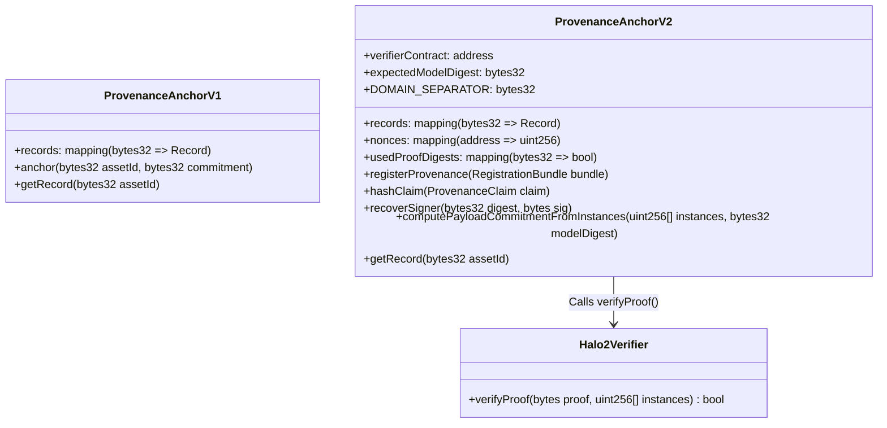

# Phase 5.0: Authenticated Blockchain Provenance — Security Architecture & Design Report

**Project:** MediaProvenance — Blockchain-Anchored Zero-Knowledge Verification of Neural Watermarks  
**Branch:** `phase5-authenticated-provenance`  
**Date:** October 20, 2026  
**Status:** Architecture Designed, Implemented, & Locally Validated  
**Author:** Antigravity Agentic Security & Cryptography Pair  

---

## 1. Executive Summary & Problem Formulation

In Phase 4.6 and Phase 4.6.1, independent audits established that while application-level feature provenance guards successfully prevent cross-image feature substitution when raw media is presented, the existing smart contract registry ([`ProvenanceAnchor.sol`](file:///d:/MediaProvenance/contracts/src/ProvenanceAnchor.sol)) possesses three critical vulnerabilities:

1. **Unauthenticated Open Writes (VULN-SC-01):** Any arbitrary Ethereum address can invoke `anchor(bytes32 assetId, bytes32 commitment)` with arbitrary data. No zero-knowledge proof, signature, or cryptographic authorization is verified on-chain.
2. **Mempool Front-Running & Asset Squatting (VULN-SC-02):** Because `records[assetId]` enforces single-registration (`require(!records[assetId].exists)`), an adversary monitoring the public mempool can intercept a creator's transaction and broadcast an identical transaction with a higher gas fee. The adversary is permanently recorded as the `submitter`, locking the legitimate creator out.
3. **Identity Decoupling (Hash != Signature) (VULN-SC-03):** Public hash commitments ($C_{\text{claim}} = \text{SHA-256}(\text{prover\_address} \parallel \dots)$) are publicly recomputable. A hash proves data consistency, but does not prove knowledge of a private key or authorized publisher intent.

**Phase 5.0 resolves these vulnerabilities** by designing and implementing [`ProvenanceAnchorV2.sol`](file:///d:/MediaProvenance/contracts/src/ProvenanceAnchorV2.sol), integrating **EIP-712 structured cryptographic signatures**, **replay/expiration protection**, **mempool front-running immunity**, and an **on-chain Halo2 zero-knowledge proof verifier** ([`Halo2Verifier.sol`](file:///d:/MediaProvenance/contracts/src/Halo2Verifier.sol)).

---

## 2. EIP-712 Typed Structured Data Architecture

To bind media identity, model version, watermark payload, proof digest, and publisher identity into an authentic, cryptographically signed statement, we adopted the Ethereum Improvement Proposal 712 (EIP-712) standard for typed structured data hashing and signing.

### 2.1 EIP-712 Domain Separator

The domain separator binds the signature to the specific deployment context, preventing cross-chain replay (e.g. Sepolia testnet to Ethereum mainnet) and cross-contract replay:

```solidity
struct EIP712Domain {
    string name;              // "MediaProvenance"
    string version;           // "2.0"
    uint256 chainId;          // block.chainid (e.g. 11155111 for Sepolia, 31337 for Hardhat)
    address verifyingContract;// address(this)
}
```

$$\text{DOMAIN\_SEPARATOR} = \text{keccak256}(\text{abi.encode}(\text{TYPEHASH}, \text{keccak256}("MediaProvenance"), \text{keccak256}("2.0"), \text{chainId}, \text{verifyingContract}))$$

### 2.2 ProvenanceClaim Schema

The canonical claim struct binds eight essential provenance fields:

```solidity
struct ProvenanceClaim {
    bytes32 assetId;          // Canonical SHA-256 digest of media asset
    bytes32 imageDigest;      // Direct cryptographic digest of candidate image
    bytes32 payloadCommitment;// C_payload = SHA-256(payload_hex || model_digest)
    bytes32 modelDigest;      // SHA-256 digest of verified ONNX decoder model
    bytes32 proofDigest;      // Keccak-256 digest of raw proof calldata
    address publisher;        // Ethereum address of author/creator
    uint256 nonce;            // Sequential per-publisher anti-replay counter
    uint256 deadline;         // Unix timestamp after which claim expires
}
```

The EIP-712 TypeHash is defined as:
```solidity
bytes32 public constant PROVENANCE_CLAIM_TYPEHASH = keccak256(
    "ProvenanceClaim(bytes32 assetId,bytes32 imageDigest,bytes32 payloadCommitment,bytes32 modelDigest,bytes32 proofDigest,address publisher,uint256 nonce,uint256 deadline)"
);
```

### 2.3 Registration Bundle & Stack-Depth Optimization

In the Ethereum Virtual Machine, functions accepting many calldata arguments exceed the 16-slot EVM stack depth ("Stack too deep"). To ensure clean compilation without requiring non-memory-safe Yul optimization, the parameters are wrapped into a single structured bundle:

```solidity
struct RegistrationBundle {
    ProvenanceClaim claim;
    bytes signature;         // 65-byte ECDSA signature (r, s, v)
    bytes zkProof;           // 3,072-byte Halo2 proof calldata
    uint256[] instances;     // 64 public instance scalar field elements
}
```

---

## 3. Game-Theoretic Defense Against Mempool Front-Running

A core requirement of Phase 5 is ensuring that registration remains secure even when transactions are publicly visible in the transaction pool (mempool) prior to block inclusion.

```mermaid
sequenceDiagram
    autonumber
    actor Alice as Legitimate Creator (Alice)
    actor Bob as Mempool Attacker (Bob)
    participant Mempool as Public Mempool / P2P Network
    participant Miner as Block Builder / Validator
    participant Contract as ProvenanceAnchorV2.sol

    Alice->>Alice: Sign EIP-712 Claim (publisher = Alice)
    Alice->>Mempool: Broadcast tx: registerProvenance(bundle_Alice)
    Note over Bob,Mempool: Bob inspects bundle in Mempool
    
    alt Attack Path A: Bob front-runs with identical bundle
        Bob->>Mempool: Broadcast front-run tx (gasPrice = 100 gwei)
        Miner->>Contract: Execute Bob's tx first
        Contract->>Contract: ecrecover(digest, sig) == claim.publisher (Alice)
        Contract->>Contract: records[assetId] = Record(publisher: Alice)
        Note over Bob,Contract: Bob pays gas fee; Alice gets registered ownership!
        Miner->>Contract: Execute Alice's tx second
        Contract-->>Alice: Reverts: "Asset already registered" (Ownership already secured)
    else Attack Path B: Bob tries to substitute publisher = Bob
        Bob->>Bob: Mutate claim.publisher = Bob
        Bob->>Mempool: Broadcast tx with Alice's signature
        Miner->>Contract: Execute Bob's tx
        Contract->>Contract: ecrecover returns Alice != claim.publisher (Bob)
        Contract-->>Bob: REVERTS: "Invalid publisher signature" (Attack Neutralized)
    end
```

### Why Front-Running Fails Mathematically

1. **Identity Bound to Signature, Not `msg.sender`:**  
   In `ProvenanceAnchor.sol` (legacy), the contract stored `submitter = msg.sender`. In `ProvenanceAnchorV2.sol`, the contract stores `publisher = claim.publisher`, which is cryptographically enforced by `ecrecover(digest, signature) == claim.publisher`.
2. **Immutability of Signed Claims:**  
   If Bob attempts to change `claim.publisher = Bob`, `claim.assetId = Fake`, or `claim.payloadCommitment = Fake`, the `structHash` changes, causing `ecrecover` to yield an address that does not match `claim.publisher`.
3. **Mempool Replay Benefit:**  
   If Bob front-runs Alice by submitting Alice's exact bundle with a higher priority gas fee, Bob pays the gas cost on Alice's behalf. When the transaction executes, the contract records Alice as the immutable publisher. When Alice's original transaction is evaluated, it reverts with `"Asset already registered"`, but Alice's authentic provenance is already permanently etched into state.

---

## 4. On-Chain Halo2 Zero-Knowledge Proof Verifier

### 4.1 Verifier Contract Generation

Using EZKL's installed API (`ezkl.create_evm_verifier`), the compiled Halo2 circuit (`models/ezkl_artifacts_pureconv/model.compiled`) and verification key (`vk.key`) were converted into an EVM Solidity verifier ([`contracts/src/Halo2Verifier.sol`](file:///d:/MediaProvenance/contracts/src/Halo2Verifier.sol)).

- **Contract Name:** `Halo2Verifier`
- **Solidity Version:** `^0.8.0` (compiled with `0.8.20`)
- **Code Size:** 73,307 bytes (1,427 lines of optimized Yul assembly)
- **Mathematical Statement:** Executes elliptic curve scalar multiplication and pairing checks on the BN254 (alt_bn128) curve using the EVM `ecPairing` precompile (address `0x08`).
- **Standard Function Signature:**
  ```solidity
  function verifyProof(
      bytes calldata proof,
      uint256[] calldata instances
  ) public returns (bool)
  ```
  Selector: `0x1e8e1e13`.

### 4.2 Exact Public Instance Layout (64 Elements)

The circuit's public instances consist of exactly 64 field elements over the BN254 scalar field ($\mathbb{F}_r$ where $r = 21888242871839275222246405745257275088548364400416034343698204186575808495617$):

$$\text{instances} = [x_0, x_1, \dots, x_{31}, y_0, y_1, \dots, y_{31}]$$

1. **Input Features ($[0 \dots 31]$):** 32 spatial carrier projection coefficients $\mathbf{x} \in \mathbb{R}^{32}$, quantized at fixed-point scale $S = 7$ ($\text{scalar} = \text{round}(x_i \cdot 128) \pmod r$).
2. **Output Logits ($[32 \dots 63]$):** 32 output logits $\mathbf{y} \in \mathbb{R}^{32}$, quantized at scale $S = 7$.

### 4.3 On-Chain Circuit-to-Payload Binding

To prevent an attacker from supplying an arbitrary `payloadCommitment` alongside a valid proof that recovered a different payload, [`ProvenanceAnchorV2.sol`](file:///d:/MediaProvenance/contracts/src/ProvenanceAnchorV2.sol#L143-L173) decodes the 32-bit watermark payload directly on-chain from `instances[32..63]`:

```solidity
function computePayloadCommitmentFromInstances(
    uint256[] calldata instances,
    bytes32 modelDigest
) public pure returns (bytes32) {
    require(instances.length >= 64, "Instances must contain at least 64 elements");

    // 1. Threshold 32 output logits at r / 2
    uint32 val = 0;
    for (uint256 i = 0; i < 32; i++) {
        uint256 elem = instances[32 + i];
        uint32 bitVal = (elem < HALF_R) ? 1 : 0;
        val = (val << 1) | bitVal;
    }

    // 2. Format 8-byte ASCII hex representation (e.g. "deadbeef")
    bytes memory hexBytes = new bytes(8);
    bytes memory hexChars = "0123456789abcdef";
    for (uint256 j = 0; j < 8; j++) {
        uint8 b = uint8((val >> (4 * (7 - j))) & 0x0F);
        hexBytes[j] = hexChars[b];
    }

    // 3. Compute SHA-256(hexBytes || modelDigest)
    return sha256(abi.encodePacked(hexBytes, modelDigest));
}
```

The contract enforces:
```solidity
bytes32 derivedCommitment = computePayloadCommitmentFromInstances(bundle.instances, claim.modelDigest);
require(derivedCommitment == claim.payloadCommitment, "Circuit output mismatch with payload commitment");
```
This guarantees that the on-chain recorded commitment is mathematically tied to the circuit's verified outputs.

---

## 5. Defense Invariants & In-Depth Threat Matrix

| Threat ID | Threat Vector | Target Layer | Mitigation Mechanism in V2 | Test Invariant |
| :---: | :--- | :---: | :--- | :--- |
| **THREAT-01** | **Unauthorized Asset Claim** | Smart Contract | EIP-712 ECDSA signature verification (`ecrecover == claim.publisher`). | `Should reject when signed by wrong publisher` |
| **THREAT-02** | **Mempool Front-Running** | EVM Mempool | Record publisher is taken from verified signature, not `msg.sender`. | `Should safely attribute publisher to Alice even when Bob front-runs` |
| **THREAT-03** | **Claim Mutation in Transit** | Network | Any change to `assetId`, `imageDigest`, or `payloadCommitment` invalidates EIP-712 digest. | `Should reject when claim attributes are substituted after signing` |
| **THREAT-04** | **Replay on Same Contract** | Smart Contract | Sequential per-publisher nonces (`nonces[publisher]++`). | `Should reject reused nonce (replay attack)` |
| **THREAT-05** | **Cross-Chain / Cross-Contract Replay** | EVM Protocol | EIP-712 `DOMAIN_SEPARATOR` includes `block.chainid` and `address(this)`. | Verified in EIP-712 domain derivation. |
| **THREAT-06** | **Proof Calldata Tampering** | Cryptographic | `Halo2Verifier.verifyProof` evaluates pairing precompile; altered bytes fail pairing check. | `Should reject corrupted ZK proof calldata` |
| **THREAT-07** | **Proof Calldata Substitution** | Application/Contract | Contract checks `keccak256(bundle.zkProof) == claim.proofDigest`. | `Should reject when zkProof calldata does not match proofDigest` |
| **THREAT-08** | **Output Logit Relabeling** | Circuit Binding | `computePayloadCommitmentFromInstances` recomputes commitment from public instances on-chain. | `Should reject altered public instance output logits` |
| **THREAT-09** | **Proof Reuse Across Assets** | Protocol | `usedProofDigests[claim.proofDigest]` mapping ensures each proof is consumed exactly once. | `Should reject reuse of the same proof digest across different assets` |
| **THREAT-10** | **Model Checkpoint Drift** | Registry | Contract asserts `claim.modelDigest == expectedModelDigest`. | `Should reject untrusted model digests` |
| **THREAT-11** | **Expired Claim Submission** | Time | Contract asserts `block.timestamp <= claim.deadline`. | `Should reject expired claims (deadline in the past)` |
| **THREAT-12** | **Asset Squatting Duplicate** | Registry | Contract asserts `!records[claim.assetId].exists`. | `Should reject duplicate registration of the same asset ID` |

---

## 6. Architecture Evolution: V1 vs. V2



---

## 7. Next Steps for Local Validation (Phase 5.0 Implementation)

With the contracts and architecture established on `phase5-authenticated-provenance`, local validation proceeds to execute:
1. Automated unit test suite execution under Hardhat local node.
2. Exact gas cost measurements for both full ZK verification and signature-only anchoring.
3. Verification of frontend service integration (`frontend/src/services/web3.ts`).
4. Production of the final validation report (`experiments/reports/phase5_local_validation.md`).
